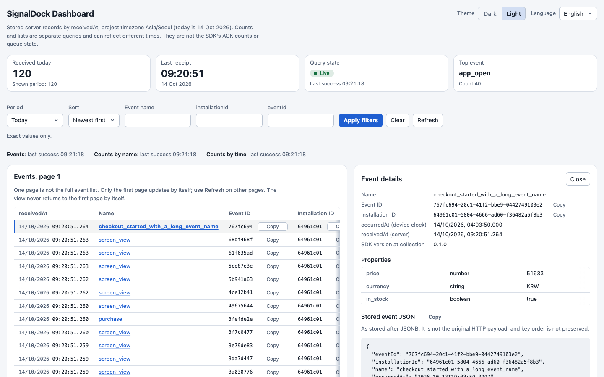
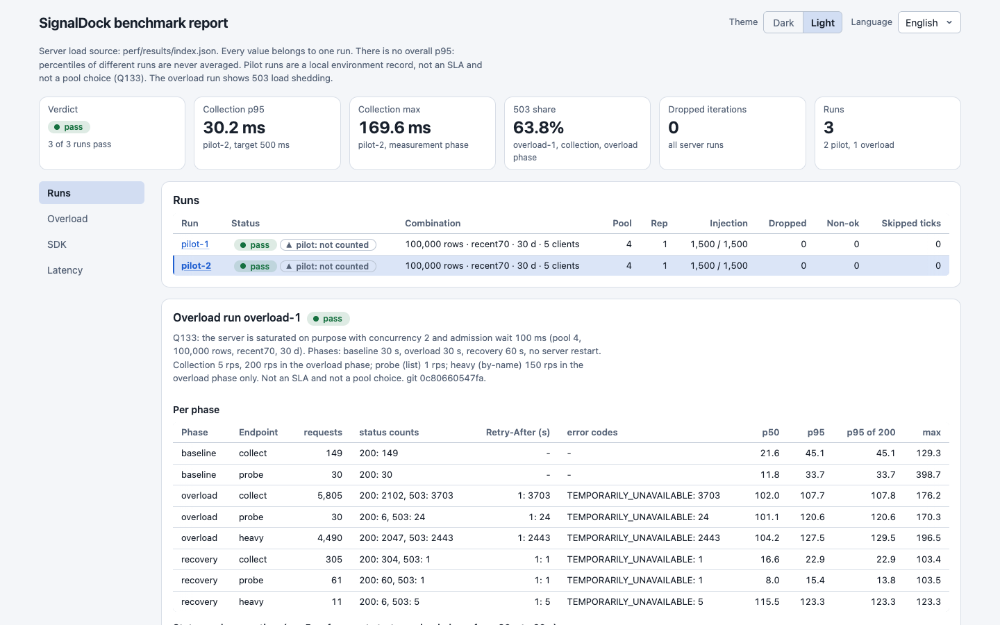

# SignalDock

[English](README.md)

기기에 이벤트를 저장하고, 서버가 commit 후 보내는 ACK로 수신을 확인하도록 설계한 Android 이벤트 SDK입니다.

이 모노레포에는 SDK, 로컬 데이터 처리 서버, 그리고 둘의 설계가 들어 있습니다.
앱의 `track()` 호출에서 시작해 durable queue, 재시도, 서버 중복 제거, 독립 아티팩트 설치까지 이어지는 경로를 검토할 수 있습니다.

> **상태: 2026-10-14**
> 첫 릴리스 범위가 완료되었습니다. SDK, 서버, Android 데모 앱, Dashboard가 구현되어 있습니다. 전송 실패 E2E, 기기 내구성, 계약·DB 변경 검사, 서버 부하 측정, SDK 기기 측정은 스크립트와 기록된 결과가 있습니다([이슈 20~24](.scratch/signaldock-portfolio/issues/)). [클린 클론에서 재현](#클린-클론에서-재현)에는 새 클론에서 실행한 명령과 검증하지 못한 항목이 정리되어 있습니다. 검증하지 못한 항목은 실기기와 서버 측정 matrix 전체(실행하지 않음, Q133)입니다.

설계 문서, ADR, 이슈 파일, `docs/reproduce.md`는 영어로만 제공합니다. 이 README는 해당 문서로 연결합니다.





스크린샷은 테스트 이벤트 120개를 넣은 Dashboard와, `perf/results/`에 기록된 실행을 보여 주는 벤치마크 보고서입니다.
데모 `track()`부터 Dashboard 수신까지 보여 주는 짧은 영상: [25-demo-track-to-dashboard.mp4](.scratch/signaldock-portfolio/evidence/25-demo-track-to-dashboard.mp4).

## 여기서 시작

1. [Architecture](architecture.md): 컴포넌트 책임, 저장소 소유권, 복구 경계.
2. [Architecture SVG](docs/architecture/signaldock-architecture.svg): onepager 구조를 정적 그림으로 보여 줍니다.
3. [Architecture onepager HTML](docs/architecture/signaldock-onepager.html): 다이어그램, 동작 순서, 설계 Q&A.
4. [Installation identity ADR](docs/adr/0001-installation-scoped-identity.md)과 [OpenAPI / JSON ADR](docs/adr/0002-openapi-json-contract.md): 결정과 tradeoff.
5. [First release spec](.scratch/signaldock-portfolio/spec.md): 입력, ACK, 오류, 수명 주기, 검증 계약.

HTML을 내려받아 로컬 브라우저에서 여세요. GitHub 파일 보기에서는 페이지가 실행되지 않습니다.
보조 문서 링크가 동작하도록 저장소 폴더 구조를 그대로 유지하세요.

macOS에서는 저장소 루트에서 다음 명령으로 문서를 미리 볼 수 있습니다.

```sh
open docs/architecture/signaldock-onepager.html
```



## 검토할 내용

SDK의 성공 응답은 호스트 앱이 다음에 무엇을 할 수 있는지 알려 줍니다.
SignalDock은 기기 내구 저장과 서버 수신을 분리하고, 각 단계마다 복구 규칙을 둡니다.
모바일 SDK 엔지니어 직무를 위한 이 포트폴리오는 공개 API 설계, 수명 주기 관리, 복구, 호환성, 독립 배포를 다룹니다.

| 설계 관심사 | 결정 | 기록된 근거 |
| --- | --- | --- |
| 저장 한도 안에서 오프라인 수집 | Room commit 시점에 수집 성공. 큐 한도에서는 기존 이벤트를 보존하고 새 호출에 `QueueFull` 반환 | 오프라인 이벤트 1,000개가 프로세스 재시작 후에도 유지됨. 동시 insert와 용량 경계를 에뮬레이터 2대에서 실행([issue 20](.scratch/signaldock-portfolio/issues/20-sdk-durability-device.md)) |
| ACK가 유실되어도 중복 저장 없음 | 같은 `eventId`로 재시도. 서버 unique 제약과 내용 비교 사용. commit 후 ACK | fault proxy가 commit 후 응답을 버림. duplicate·conflict 결과와 unique row 수·집계를 비교([issue 21](.scratch/signaldock-portfolio/issues/21-delivery-failure-e2e.md)) |
| 포그라운드 응답과 백그라운드 복구 | sender와 durable 재시도 상태를 WorkManager와 공유. 수집 쓰기는 전송 lock과 분리 | sender 경합, 취소, Worker 복구, 재시작 후 재시도 대기를 에뮬레이터 2대에서 실행([issue 20](.scratch/signaldock-portfolio/issues/20-sdk-durability-device.md)) |
| 공유 계약과 독립 릴리스 | OpenAPI / JSON과 생성 소스 drift 검사. 별도 R8 consumer 앱에 Maven ZIP 설치 | round trip, 이전 버전 fixture, DB migration([issue 22](.scratch/signaldock-portfolio/issues/22-contract-db-change-checks.md)). Maven ZIP 설치와 R8 release consumer 앱([issue 06](.scratch/signaldock-portfolio/issues/06-distribution.md), [ADR-0009](docs/adr/0009-maven-zip-and-consumer-app.md)) |

엔지니어링 판단: [설계 리뷰, 장애 모드, 포스트모템, 위협 모델](docs/engineering/README.md) (영어 문서).

## 이벤트 흐름

1. 초기화에 성공하면 호스트 앱이 `track()`을 호출합니다. 입력 검증과 Room 저장이 끝나면 수집 성공입니다.
2. 공유 sender가 가장 이른 재시도 시각을 확인하고 batch를 보냅니다. HTTP 중에는 Room transaction을 열어 두지 않습니다.
3. 서버가 각 이벤트를 검증하고 중복을 처리한 뒤, PostgreSQL commit 후 ACK를 반환합니다.
4. SDK는 ACK 전체를 검증한 뒤에 큐 변경을 atomic하게 적용합니다. 모호한 ACK는 batch 전체를 큐에 남깁니다.
5. 앱 진단 화면은 기기 큐와 최근 ACK를 보여 줍니다. Dashboard는 서버에 저장된 이벤트와 상세 내용을 보여 줍니다.

ACK가 유실되어도 이벤트 ID는 바뀌지 않습니다. 같은 ID와 같은 내용은 duplicate 성공이 되고, 내용이 다르면 conflict 거부가 됩니다.
중복 제거는 서버 row가 남아 있는 동안만 유지됩니다. 이 설계는 exactly-once 전달을 주장하지 않습니다.

## 스택

| 영역 | 선택 |
| --- | --- |
| Android SDK | Kotlin · minSdk 24 · Coroutines · Room · Retrofit / OkHttp · kotlinx.serialization · WorkManager |
| 데모 앱 | Jetpack Compose · ViewModel. SDK는 이 UI 스택에 의존하지 않습니다 |
| 서버 | Kotlin / Ktor · PostgreSQL · jOOQ · JDBC / HikariCP · Flyway |
| 검증 Dashboard | React · TypeScript · Vite · Recharts |
| 계약과 배포 | OpenAPI / JSON · Git으로 추적하는 생성 소스 · Docker Compose 진입점 · 로컬 Maven 저장소 ZIP |

정확한 버전은 `gradle/libs.versions.toml`에 고정되어 있습니다. [TOOLCHAIN.md](TOOLCHAIN.md)에 각 고정의 이유와 이를 검증한 빌드가 있습니다(영어).
첫 좌표는 `local.signaldock:sdk-android:0.1.0`입니다(로컬 전용이며 Maven Central이 아닙니다). ZIP은 아래 설명대로 빌드합니다.

## 범위와 검증

첫 릴리스는 네이티브 Android SDK 하나와 로컬 프로젝트 하나를 다룹니다.
데모는 상품 조회, 장바구니, 모의 구매 흐름을 따릅니다. Dashboard는 SDK 연동을 검증하는 데 도움을 줍니다.
iOS / Flutter, React Native / Flutter / Unity 또는 WebView(native-web) bridge(Q150), 자동 이벤트, `identify`, 캠페인 / push, 퍼널, 다중 계정, 공개 인터넷 운영, Maven Central은 이번 릴리스에 포함하지 않습니다.

[완료 기준](.scratch/signaldock-portfolio/spec.md#7-completion-criteria-and-verification-plan)은 환경 기록, 소스 revision / hash, 이벤트 ID 비교를 요구합니다. `.scratch/signaldock-portfolio/issues/`의 각 구현 이슈는 무엇을 실행했고 무엇을 실행하지 않았는지 기록합니다.
측정 결과는 로컬 환경 기록이며 SLA가 아닙니다.

- 서버: Docker 제한이 있는 Mac 한 대에서 pilot 2회와 overload 1회를 실행했습니다. 결과는 [`perf/results/`](perf/results/)에 있습니다. overload 실행은 `Retry-After`가 붙은 HTTP 503과, 재시작 없는 복구를 보여 줍니다. 216회 pool 크기 matrix는 실행하지 않았습니다(Q133, [ADR-0013](docs/adr/0013-server-load-measurement-harness.md), [issue 23](.scratch/signaldock-portfolio/issues/23-server-load-measurement.md)).
- SDK: debug 빌드로 API 24와 API 37 에뮬레이터에서 normal, offline, burst를 실행했고, API 37 에뮬레이터에서 R8 release 빌드(debug 서명)로 한 번 더 실행했습니다. 결과는 [`perf/sdk-results/summary.md`](perf/sdk-results/summary.md)에 있습니다([ADR-0014](docs/adr/0014-sdk-device-measurement-harness.md), [ADR-0018](docs/adr/0018-sdk-release-r8-measurement.md), [issue 24](.scratch/signaldock-portfolio/issues/24-sdk-device-measurement.md), [issue 33](.scratch/signaldock-portfolio/issues/33-sdk-crash-safety-and-release-build.md)).
- 호스트 앱이 치르는 SDK 비용: API 37 에뮬레이터에서 SDK가 있는 R8 consumer 앱과 없는 앱을 비교했습니다. APK는 616,829 bytes(dex는 966,108 bytes) 커지고, 콜드 스타트 `TotalTime` p50은 SDK 없음 235 ms, 있음 238 ms이며, `initialize()`는 메인 스레드를 p50 0.26 ms, p95 3.0 ms 사용하고, 5초 유휴 후 PSS는 4.0 MiB 더 큽니다([`perf/sdk-results/host-cost-api37/summary.md`](perf/sdk-results/host-cost-api37/summary.md), [ADR-0020](docs/adr/0020-sdk-host-app-cost.md), [issue 36](.scratch/signaldock-portfolio/issues/36-sdk-host-app-cost.md)).
- CI: GitHub Actions에서 API 34 `google_apis` x86_64 에뮬레이터로 계측 SDK 테스트 26개를 실행하고(`device-test` job), SDK가 R8 consumer APK를 700,000 bytes보다 더 키우면 빌드를 실패시키는 크기 게이트가 있습니다(`size-budget` job). `scripts/device-durability.sh`의 프로세스 경계 케이스와 측정은 로컬에서만 실행합니다([ADR-0023](docs/adr/0023-ci-device-tests-and-size-budget.md), [issue 40](.scratch/signaldock-portfolio/issues/40-ci-device-tests-and-size-budget.md)).
- [성능 계획](.scratch/signaldock-portfolio/performance-plan.md)에는 처음의 목표와 조건이 있습니다.

스택 실행, 중지, 초기화 방법과 Maven ZIP 빌드, consumer 앱 실행 방법은 아래에 있습니다.

## 클린 클론에서 재현

이 절의 명령은 `docker compose down --volumes`(초기화)를 제외하고 모두 새 클론에서 실행했습니다. 초기화는 의도적으로 실행하지 않았습니다. 기록(명령, 결과, 소요 시간)은 [issue 25](.scratch/signaldock-portfolio/issues/25-reproduction-readme-video.md)에 있습니다. 더 긴 안내(데모 앱, E2E, 기기 스크립트, 측정, 실기기, 초기화, 한계)는 [docs/reproduce.md](docs/reproduce.md)에 있습니다(영어).
데모의 `track()`부터 Dashboard 수신까지 보여 주는 짧은 영상은 [`.scratch/signaldock-portfolio/evidence/25-demo-track-to-dashboard.mp4`](.scratch/signaldock-portfolio/evidence/25-demo-track-to-dashboard.mp4)에 있습니다.
처음 실행할 때는 JDK, Docker 이미지, Gradle 의존성, npm 패키지를 내려받습니다. 완전한 오프라인 실행은 아닙니다.

필요한 것: macOS 또는 Linux, Compose가 있는 Docker, Python 3, `curl`, `openssl`, platform `android-36`이 있는 Android SDK(`ANDROID_HOME`). 기기 스크립트에는 에뮬레이터(AVD)도 필요합니다. `scripts/device-measure.sh`는 macOS도 필요합니다.

### 1. 툴체인과 hook

```sh
git clone https://github.com/HyeokjaeChoi/signaldock.git && cd signaldock
git config core.hooksPath .githooks     # once per clone
scripts/setup-toolchain.sh              # JDK 21, oasdiff, OpenAPI generator -> .tools/
```

버전과 hash는 [TOOLCHAIN.md](TOOLCHAIN.md)에 있습니다. `JAVA_HOME`이 설정되어 있지 않으면 Gradle 스크립트는 `.tools/jdk-21.0.12.1+1`을 사용합니다.

### 2. 서버, PostgreSQL, Dashboard (Compose)

`.env`를 만들고 각 secret에 무작위 값을 넣습니다. 두 key는 서로 달라야 합니다(같으면 서버가 시작을 거부합니다). `.env`는 절대 commit하지 마세요.

```sh
cp .env.example .env
for v in SIGNALDOCK_COLLECTION_KEY SIGNALDOCK_QUERY_KEY SIGNALDOCK_DB_PASSWORD; do
  sed -i.bak "s|^$v=.*|$v=$(openssl rand -hex 24)|" .env
done
rm .env.bak
chmod 600 .env                          # owner-only: the file holds keys and a password
docker compose up -d --build            # PostgreSQL, server, Dashboard
curl -s -o /dev/null -w '%{http_code}\n' http://127.0.0.1:5173/   # 200 = Dashboard is up
```

- Dashboard: `http://127.0.0.1:5173`(`SIGNALDOCK_DASHBOARD_PORT`). 호스트의 서버 endpoint: `http://127.0.0.1:8080`. 서버 컨테이너는 `0.0.0.0:8080`에 bind하고, Compose는 모든 호스트 포트를 `127.0.0.1`에만 게시합니다.
- 앱은 `SIGNALDOCK_COLLECTION_KEY`로 이벤트를 보냅니다. Dashboard는 key를 갖지 않습니다. nginx가 `GET /v1/*`를 프록시하면서 `SIGNALDOCK_QUERY_KEY`를 붙입니다([ADR-0008](docs/adr/0008-dashboard-and-compose-delivery.md)).
- 개발 모드: `docker compose up -d db`를 실행한 뒤, `server/`에서 `.env.example`의 변수로 서버를 실행하고 `dashboard/`에서 `npm run dev`를 실행합니다.

### 3. SDK Maven ZIP과 독립 consumer 앱

```sh
export ANDROID_HOME="$HOME/Library/Android/sdk"     # your Android SDK path
scripts/verify-consumer.sh
```

이 스크립트는 `signaldockMavenZip`을 빌드하고, 깨끗한 임시 폴더에 풀고, 그 폴더만 사용해 `compatibility/consumer-android/`를 좌표 `local.signaldock:sdk-android:0.1.0`으로 R8 release로 빌드합니다. AAR의 Kotlin metadata 버전을 확인하고 ZIP, 폴더, APK 경로를 출력합니다. 폴더를 남기려면 먼저 `SIGNALDOCK_REPO_DIR`을 새 빈 경로로 설정하세요. ZIP만 만들려면 `sdk/gradlew -p sdk :sdk-android:signaldockMavenZip --no-daemon`을 실행합니다(출력은 `sdk/sdk-android/build/distributions/signaldock-sdk-android-0.1.0-maven.zip`). [ADR-0009](docs/adr/0009-maven-zip-and-consumer-app.md)를 참고하세요.

이제 R8 release APK를 에뮬레이터에서 실행해 서버에 연결합니다. collection key는 빌드 시점에 포함됩니다.

```sh
SIGNALDOCK_REPO_DIR=/tmp/signaldock-maven scripts/verify-consumer.sh   # new or empty folder
set -a; . ./.env; set +a
compatibility/consumer-android/gradlew -p compatibility/consumer-android \
  -Psignaldock.repo=/tmp/signaldock-maven -Psignaldock.collectionKey="$SIGNALDOCK_COLLECTION_KEY" :app:assembleRelease
"$ANDROID_HOME/emulator/emulator" -avd signaldock-api37 -no-window -no-audio -no-boot-anim -no-snapshot-save -port 5584 &
adb -s emulator-5584 install -r compatibility/consumer-android/app/build/outputs/apk/release/app-release.apk
adb -s emulator-5584 shell am start -n local.signaldock.consumer/.MainActivity
```

"Track consumer_ping"을 누르고 약 15초 기다린 뒤 "Show diagnostics"를 누릅니다. `lastAck`에 `accepted=1`이 표시되고, 이벤트가 Dashboard에 나타납니다. 기본 endpoint는 `http://10.0.2.2:8080`입니다(에뮬레이터에서 호스트를 가리키는 이름). `-Psignaldock.endpoint=...`로 바꿀 수 있습니다. 앱은 `10.0.2.2`, `127.0.0.1`, `localhost`에 대해서만 cleartext를 허용합니다. USB로 연결한 실기기에서는 `adb -s <device-serial> reverse tcp:8080 tcp:8080`을 실행하고(serial은 `adb devices`에서 확인합니다. 에뮬레이터도 연결되어 있으면 필요합니다), `-Psignaldock.endpoint=http://127.0.0.1:8080`으로 빌드합니다([docs/reproduce.md](docs/reproduce.md) 참고).

### 4. 데모 앱, E2E, 기기 검사, 측정

[docs/reproduce.md](docs/reproduce.md)를 참고하세요(영어). 데모 앱은 `sdk/gradlew -p sdk -Psignaldock.collectionKey=... :demo:app:assembleDebug`로 빌드합니다. `scripts/e2e-delivery.sh`는 전송 실패 사례를 실행합니다. `scripts/device-durability.sh`와 `scripts/device-measure.sh`는 에뮬레이터에서 실행합니다. `perf/`에는 서버 부하 harness가 있습니다.

### 5. 중지와 초기화

```sh
docker compose stop                     # stop; the DB volume is kept
docker compose down                     # remove containers; the DB volume is kept
docker compose down --volumes           # RESET: deletes the DB volume and ALL stored events
```

경고: `--volumes`는 PostgreSQL 데이터를 삭제합니다. 되돌릴 수 없습니다. 빈 데이터베이스가 필요할 때만 사용하세요. 에뮬레이터는 `adb -s emulator-5584 emu kill`로 중지합니다.

### 한계

- 로컬 전용입니다. 스택은 `127.0.0.1`에 bind하고, 예시 수준의 secret을 사용하며, TLS가 없습니다. 공개 인터넷용이 아닙니다.
- 성능 수치는 Docker 제한이 있는 Mac 한 대에서 측정한 값입니다. SLA가 아니며 pool 크기를 정하는 근거도 아닙니다([ADR-0013](docs/adr/0013-server-load-measurement-harness.md)).
- SDK 기기 측정은 에뮬레이터에서만 했습니다. API 24와 API 37은 debug 빌드, API 37은 R8 release 빌드입니다([ADR-0014](docs/adr/0014-sdk-device-measurement-harness.md), [ADR-0018](docs/adr/0018-sdk-release-r8-measurement.md)). 실제 기기에서는 측정하지 않았습니다.
- cleartext HTTP는 `10.0.2.2`, `127.0.0.1`, `localhost`에서만 동작합니다(실기기: `adb reverse`, [docs/reproduce.md](docs/reproduce.md) 참고). HTTP로 LAN 주소를 쓰는 것은 지원하지 않습니다. `adb reverse` 경로는 에뮬레이터에서만 테스트했으며, 실기기는 사용하지 않았습니다.
- 스크립트는 에뮬레이터만 받습니다. `scripts/device-measure.sh`는 macOS가 필요합니다.
- 중복 제거는 서버 row가 남아 있는 동안만 유지됩니다. 이 설계는 exactly-once 전달을 주장하지 않습니다.

## 앱에 SDK 추가

Maven repository ZIP과 `.sha256` 파일은 GitHub Release [`v0.1.0`](https://github.com/HyeokjaeChoi/signaldock/releases/tag/v0.1.0)의 배포 파일입니다([릴리스 노트](docs/releases/v0.1.0.md), [변경 이력](CHANGELOG.md)). `scripts/release.sh 0.1.0`이 둘을 `dist/`에 만듭니다. ZIP을 검증한 뒤 폴더에 푸세요.

```sh
shasum -a 256 -c signaldock-sdk-android-0.1.0-maven.zip.sha256   # 두 파일이 있는 폴더에서 실행
```

그 폴더를 repository로 추가하고 좌표에 의존하세요.

```kotlin
// settings.gradle.kts
dependencyResolutionManagement {
    repositories {
        google()
        mavenCentral()
        maven {
            url = uri("/path/to/unzipped/folder")
            content { includeGroup("local.signaldock") }
        }
    }
}
// app/build.gradle.kts
dependencies { implementation("local.signaldock:sdk-android:0.1.0") }
```

0.1.0 AAR의 요구 사항:

- `compileSdk` 36 이상(`aarMetadata.minCompileSdk=36`, [ADR-0006](docs/adr/0006-sdk-delivery-decisions.md)), `minSdk` 24 이상.
- Kotlin 2.2 이상과 AGP 9.x. SDK metadata가 2.2이므로, AGP 9의 기본 built-in Kotlin으로 추가 Kotlin 플러그인 없이 동작합니다([ADR-0009](docs/adr/0009-maven-zip-and-consumer-app.md), Q132).
- 호스트 앱이 `INTERNET`을 선언해야 합니다. SDK 자체의 R8 규칙은 필요 없습니다. 앱이 해당 host에 cleartext를 허용하지 않으면 `https://` endpoint를 설정해야 합니다. SDK는 `http://` endpoint를 HTTPS로 바꾸지 않습니다(ADR-0009).
- `SignalDock.initialize(context, SignalDockConfig(endpoint, collectionKey))`를 한 번 호출합니다(예: `Application.onCreate`). 이후 반환된 인스턴스에서 `track("name") { property("key", value) }`와 `diagnostics()`를 호출합니다.

### 지원 버전

| 항목 | 0.1.x |
| --- | --- |
| 최소 Android API (`minSdk`) | 24 |
| 호스트 앱의 `compileSdk` | 36 이상 |
| Kotlin | 2.2 이상 |
| Android Gradle Plugin | 9.x |

SDK는 1.0 이전입니다. 수정은 가능한 범위에서 제공합니다(best effort). 호환성을 깨는 변경과 deprecation은 [docs/versioning.md](docs/versioning.md), 취약점 신고는 [SECURITY.md](SECURITY.md), 기여는 [CONTRIBUTING.md](CONTRIBUTING.md)를 참고하세요.

[SDK 통합 가이드](docs/integration-guide.ko.md)([English](docs/integration-guide.md))는 `track()` 결과, 취소, 오프라인과 재시도 동작, diagnostics, 개인정보, 버전, 문제 해결을 다룹니다. 선택 사항으로, tracking plan에서 생성한 타입 있는 이벤트 함수는 [`tracking-plan/`](tracking-plan/)과 [ADR-0021](docs/adr/0021-tracking-plan-codegen.md)을 참고하세요. 서버는 저장한 이벤트마다 그 plan과 비교해 `planned`, `unplanned_event`, `invalid_properties` 중 하나로 표시하며, 이벤트를 거부하지 않습니다([ADR-0022](docs/adr/0022-server-tracking-plan-status.md)).

## 저장소 안내

저장소에는 설계 문서와, `sdk/`, `server/`, `dashboard/` 아래의 제품 코드가 있습니다.
`.scratch/signaldock-portfolio/`의 spec, 검증 계획, 구현 이슈는 Git으로 추적하는 승인된 설계 소스입니다. 개인 대화와 이력서 검토 기록은 제외했습니다.

| 경로 | 내용 |
| --- | --- |
| [architecture.md](architecture.md) | SDK와 서버 경계. ACK, 재시도, 계약, 배포 설계 |
| [docs/architecture/](docs/architecture/) | 다이어그램, onepager HTML, 원문 텍스트 |
| [docs/adr/](docs/adr/) | Architecture decision record, 결정마다 파일 하나 |
| [GLOSSARY.md](GLOSSARY.md) | 수집 성공, 수신 성공, installation ID, event ID 정의 |
| [.scratch/signaldock-portfolio/spec.md](.scratch/signaldock-portfolio/spec.md) | 상세 설계와 완료 기준 |
| [.scratch/signaldock-portfolio/final-review.md](.scratch/signaldock-portfolio/final-review.md) | 최종 설계 검토 |
| [.scratch/signaldock-portfolio/dashboard-verification-defaults.md](.scratch/signaldock-portfolio/dashboard-verification-defaults.md) | Dashboard 조회와 표시 기본값 |
| [.scratch/signaldock-portfolio/performance-plan.md](.scratch/signaldock-portfolio/performance-plan.md) | 성능 테스트 조건, 기준, 원시 데이터 계획 |
| [.scratch/signaldock-portfolio/issues/](.scratch/signaldock-portfolio/issues/) | 구현 작업 |

이 프로젝트는 Apache License 2.0을 따릅니다. [LICENSE](LICENSE)를 보세요.
