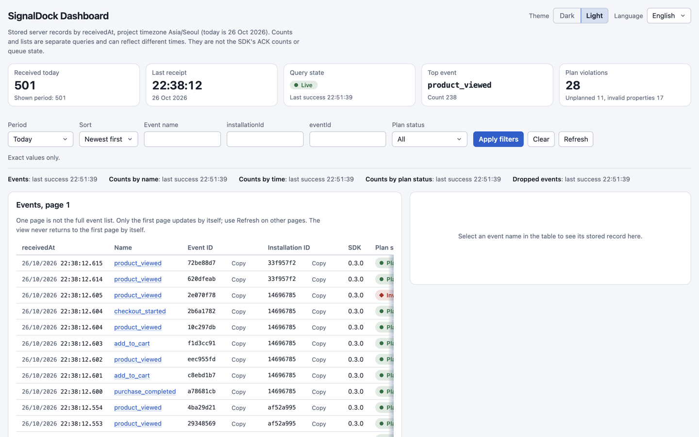
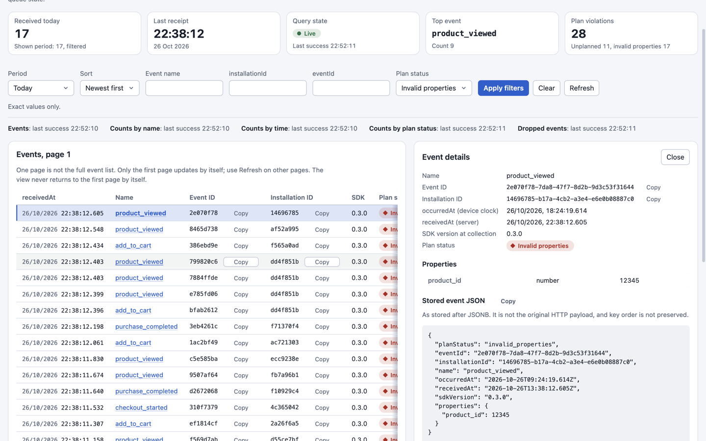
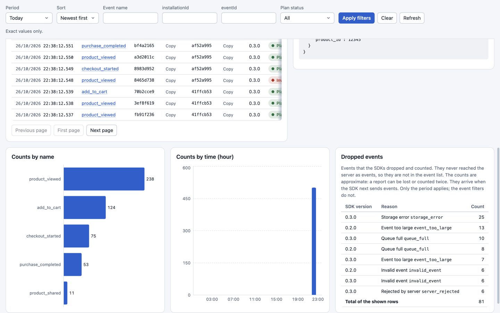

# SignalDock

[한국어](README.ko.md)

Android and iOS event SDKs designed to save events on the device and confirm server receipt through an ACK after commit.

This monorepo contains the SDK, a local data processing server, and their design.
Review the path from an app's `track()` call through a durable queue, retries, server deduplication, and independent artifact installation.

> **Status: 2026-10-21**
> The first release scope is done, and SDK v0.3.0 is released. It adds a server collection kill switch, a Baseline Profile in the AAR, a build provenance attestation for the release ZIP, and Gradle dependency verification ([CHANGELOG.md](CHANGELOG.md)). The public API does not change from 0.2.0. The SDK, the server, the Android demo app, and the Dashboard are implemented. Delivery failure E2E, device durability, contract and DB change checks, server load measurement, and SDK device measurement have scripts and recorded results ([issues 20 to 24](.scratch/signaldock/issues/)). [Reproduce from a clean clone](#reproduce-from-a-clean-clone) lists the commands that were run in a fresh clone, and what was not verified: the process-boundary script, the release (R8) build and the Baseline Profile on a physical device (the instrumented tests, the debug device measurement, and the host-app cost ran on one phone with SDK 0.3.0, [issue 85](.scratch/signaldock/issues/85-device-verification-v0.3.0.md); the instrumented tests also ran with 0.2.0 code, [issue 73](.scratch/signaldock/issues/73-real-device-test-galaxy-z-flip7.md)), and the full server measurement matrix (not run, Q133).
>
> **iOS SDK 0.1.0: 2026-10-29.** The iOS SDK (`sdk-ios/`), its consumer and demo app, the Simulator durability script, and the release ZIP workflow are in the repository. No iOS release exists yet: the first tag, `ios-v0.1.0`, needs the owner's approval to push, and Android SDK 0.4.0 (which sends `sdkPlatform`) is not tagged either. See [iOS SDK](#ios-sdk).


The screenshots show the Dashboard and the benchmark report with 120 seeded test events and the recorded runs in `perf/results/`.
A short video of demo `track()` to Dashboard receipt: [25-demo-track-to-dashboard.mp4](.scratch/signaldock/evidence/25-demo-track-to-dashboard.mp4).

These three screenshots are from the live cloud demo on 2026-10-26 UTC. They show its seed data (`scripts/demo-seed.py`).







## Start here

1. [Architecture](architecture.md): component responsibilities, storage ownership, and recovery boundaries.
2. [Architecture SVG](docs/architecture/signaldock-architecture.svg): a static view of the onepager's structure.
3. [Architecture onepager HTML](docs/architecture/signaldock-onepager.html): diagrams, operation sequence, and design Q&A.
4. [Installation identity ADR](docs/adr/0001-installation-scoped-identity.md) and [OpenAPI / JSON ADR](docs/adr/0002-openapi-json-contract.md): decisions and tradeoffs.
5. [First release spec](.scratch/signaldock/spec.md): input, ACK, error, lifecycle, and verification contracts.

Download the HTML and open it in a local browser. GitHub's file view does not run the page.
Keep the repository's folder structure so the supporting document links work.

On macOS, run this from the repository root to preview the document:

```sh
open docs/architecture/signaldock-onepager.html
```


## What to review

An SDK's success response tells the host app what it can do next.
SignalDock separates durable device storage from server receipt, with recovery rules for each stage.
This open-source release from Stackline covers public API design, lifecycle management, recovery, compatibility, and independent distribution.

| Design concern | Decision | Recorded evidence |
| --- | --- | --- |
| Offline collection within a storage limit | Collection succeeds at Room commit. At the queue limit, preserve existing events and return `QueueFull` for new calls | 1,000 offline events survived a process restart; concurrent inserts and capacity boundaries ran on two emulators ([issue 20](.scratch/signaldock/issues/20-sdk-durability-device.md)) |
| Lost ACKs without duplicate storage | Retry with the same `eventId`. Use a server unique constraint and content comparison; ACK after commit | A fault proxy dropped the response after commit; duplicate and conflict results; unique rows and counts compared ([issue 21](.scratch/signaldock/issues/21-delivery-failure-e2e.md)) |
| Foreground response and background recovery | Share the sender and durable retry state with WorkManager. Keep collection writes separate from the send lock | Sender contention, cancellation, Worker recovery, and retry waits across restart ran on two emulators ([issue 20](.scratch/signaldock/issues/20-sdk-durability-device.md)) |
| Shared contracts and independent releases | OpenAPI / JSON with generated source drift checks. Install the Maven ZIP in a separate R8 consumer app | Round trips, earlier-version fixtures, and DB migrations ([issue 22](.scratch/signaldock/issues/22-contract-db-change-checks.md)); Maven ZIP installation and an R8 release consumer app ([issue 06](.scratch/signaldock/issues/06-distribution.md), [ADR-0009](docs/adr/0009-maven-zip-and-consumer-app.md)) |

Engineering judgment: [design review, failure modes, postmortems, and threat model](docs/engineering/README.md).

## Event flow

1. After initialization succeeds, the host app calls `track()`. Collection succeeds after input validation and Room storage.
2. The shared sender checks the earliest retry time and sends a batch. It holds no Room transaction open during HTTP.
3. The server validates each event, handles duplicates, and returns an ACK after PostgreSQL commit.
4. The SDK validates the entire ACK before it applies queue changes atomically. An ambiguous ACK leaves the whole batch in the queue.
5. App diagnostics show the device queue and recent ACK. The Dashboard shows stored server events and their details.

A lost ACK does not change the event ID. The same ID and content produce duplicate success; different content produces a conflict rejection.
Deduplication lasts while the server row exists. The design does not claim exactly-once delivery.

The SDK counts the events it drops, by reason, and reports the counts to `POST /v1/client-reports` ([ADR-0036](docs/adr/0036-sdk-client-reports.md)). The Dashboard shows them in a "Dropped events" card. The counts are approximate.

## Stack

| Area | Choice |
| --- | --- |
| Android SDK | Kotlin · minSdk 24 · Coroutines · Room · Retrofit / OkHttp · kotlinx.serialization · WorkManager |
| iOS SDK | Swift 6 · iOS 15 · Swift Concurrency · system SQLite · `URLSession` · no external dependency |
| Demo app | Jetpack Compose · ViewModel. The SDK has no dependency on this UI stack |
| Server | Kotlin / Ktor · PostgreSQL · jOOQ · JDBC / HikariCP · Flyway |
| Verification Dashboard | React · TypeScript · Vite · Recharts |
| Contracts and distribution | OpenAPI / JSON · generated sources tracked in Git · Docker Compose entry point · local Maven repository ZIP · Swift package source ZIP |
| CI and supply chain | GitHub Actions · CodeQL · Renovate · `dependency-guard` baseline · `binary-compatibility-validator` · Gradle wrapper validation · Gradle dependency verification · build provenance attestation |

Exact versions are pinned in `gradle/libs.versions.toml`. [TOOLCHAIN.md](TOOLCHAIN.md) gives the reason for each pin and the build that verified it.
The first coordinate is `local.signaldock:sdk-android:0.3.0` (local only, not Maven Central). Build the ZIP as described below.

## Scope and verification

The first release covers a native Android SDK and one local project. The iOS SDK `0.1.0` (not released yet) has the same behavior for iOS apps.
The demo follows product view, cart, and simulated purchase. The Dashboard helps verify SDK integration.
Flutter, React Native, Unity or WebView (native-web) bridges (Q150), automatic events, `identify`, campaign / push, funnels, multiple accounts, public internet operation, and Maven Central are outside this release.

The [completion criteria](.scratch/signaldock/spec.md#7-completion-criteria-and-verification-plan) require environment records, source revision/hash, and event ID comparisons. Each implementation issue in `.scratch/signaldock/issues/` records what ran and what did not.
Measured results are local environment records, not an SLA:

- Server: two pilot runs and one overload run on one Mac with Docker limits, in [`perf/results/`](perf/results/). The overload run shows HTTP 503 with `Retry-After` and recovery without a restart. The 216-run pool-size matrix was not run (Q133, [ADR-0013](docs/adr/0013-server-load-measurement-harness.md), [issue 23](.scratch/signaldock/issues/23-server-load-measurement.md)).
- SDK: normal, offline, and burst runs on API 24 and API 37 emulators with a debug build, and once more on the API 37 emulator with an R8 release build (debug-signed), in [`perf/sdk-results/summary.md`](perf/sdk-results/summary.md) ([ADR-0014](docs/adr/0014-sdk-device-measurement-harness.md), [ADR-0018](docs/adr/0018-sdk-release-r8-measurement.md), [issue 24](.scratch/signaldock/issues/24-sdk-device-measurement.md), [issue 33](.scratch/signaldock/issues/33-sdk-crash-safety-and-release-build.md)).
- SDK cost for a host app, on the API 37 emulator with the R8 consumer app with and without the SDK: the APK grows by 616,829 bytes (dex by 966,108 bytes), cold start `TotalTime` p50 is 235 ms without and 238 ms with the SDK, `initialize()` takes 0.26 ms (p50) and 3.0 ms (p95) of the main thread, and PSS is 4.0 MiB higher after 5 s idle ([`perf/sdk-results/host-cost-api37/summary.md`](perf/sdk-results/host-cost-api37/summary.md), [ADR-0020](docs/adr/0020-sdk-host-app-cost.md), [issue 36](.scratch/signaldock/issues/36-sdk-host-app-cost.md)).
- Baseline Profile of the SDK, on the API 37 emulator with Macrobenchmark (20 cold starts per row, metric: `initialize()`, 20 `track()` calls, and `diagnostics()` in a sample app): the p50 is 495 ms and 749 ms with no compilation and 358 ms and 351 ms with the profile in two runs (28 % and 53 % lower; a third run gave 413 ms and 410 ms). With the SDK rules removed it is 387 ms, so the SDK rules alone are inside the noise of an emulator, and the same mode varies by 50 % between runs. The Baseline Profile was not measured on a physical device ([`perf/sdk-results/baseline-profile-api37/`](perf/sdk-results/baseline-profile-api37/), [ADR-0040](docs/adr/0040-sdk-baseline-profile.md), [issue 70](.scratch/signaldock/issues/70-sdk-baseline-profile.md)).
- CI: the `repo-rules` workflow has the jobs `check`, `verify-contract`, `sdk-test`, `consumer-r8`, `server-test`, `device-test`, `size-budget`, and `gradle-wrapper`. Other workflows are `pr-description` (`length` job), `codeql`, `release` (`build` and `publish` jobs), `claude-review` (`review` job, [ADR-0041](docs/adr/0041-claude-code-pr-review.md)), and `demo-deploy` (`build` and `wait-deployed` jobs; it runs only on `demo-v*` tags, [ADR-0043](docs/adr/0043-cloud-demo-hosting-and-deploy.md)). The `device-test` job runs the instrumented SDK tests on an API 34 `google_apis` x86_64 emulator: 33 tests start, 16 skip themselves (the phase classes need `-e phase`), and 17 run (job log of `repo-rules` run 39032066203 of PR #173, 2026-10-17 UTC). A size gate fails the build when the SDK adds more than 700,000 bytes to the R8 consumer APK (`size-budget` job). iOS jobs of `repo-rules` on a macOS runner: `ios-test` (lint, Thread Sanitizer tests, `xcodebuild analyze`, privacy manifest, public API check), `ios-sanitize` (Address and Undefined Behavior Sanitizer tests), `ios-consumer` (builds `consumer-ios` in Debug and Release from the release ZIP), and `ios-size-budget` (fails when the SDK adds more than 175,000 bytes in `.ipa` form or 440,000 bytes of main binary to the consumer Release build, ADR-0047 ticket 17 amendment); `codeql` also analyzes Swift, and `release-ios` (`build` and `publish` jobs) runs only on `ios-v*.*.*` tags ([ADR-0047](docs/adr/0047-ios-sdk.md) D13). The process-boundary cases of `scripts/device-durability.sh` and `scripts/simulator-durability.sh` and the measurements stay local ([ADR-0023](docs/adr/0023-ci-device-tests-and-size-budget.md), [issue 40](.scratch/signaldock/issues/40-ci-device-tests-and-size-budget.md)).
- The [performance plan](.scratch/signaldock/performance-plan.md) holds the original targets and conditions.

Steps to run, stop, and reset the stack, to build the Maven ZIP, and to run the consumer app are below.

## Reproduce from a clean clone

The commands in this section were run in a fresh clone, except `docker compose down --volumes` (the reset), which was not run on purpose. The record (commands, results, wall times) is in [issue 25](.scratch/signaldock/issues/25-reproduction-readme-video.md). The longer guide (demo app, E2E, device scripts, measurements, physical device, reset, limits) is [docs/reproduce.md](docs/reproduce.md). The iOS steps were not part of that run. They ran later in a clean `git worktree`, recorded in [issue 18](.scratch/ios-sdk/issues/18-ios-docs.md): the release ZIP, `scripts/verify-consumer-ios.sh`, the Simulator launch against a separate stack, `scripts/simulator-durability.sh` with the cases `offline` and `restart`, and `scripts/verify-ios.sh` `lint` and `manifest`. `tsan`, `asan`, `analyze`, and the other durability cases did not run there.
A short video of demo `track()` to Dashboard receipt is in [`.scratch/signaldock/evidence/25-demo-track-to-dashboard.mp4`](.scratch/signaldock/evidence/25-demo-track-to-dashboard.mp4).
The first run downloads the JDK, Docker images, Gradle dependencies, and npm packages. It is not fully offline.

You need: macOS or Linux, Docker with Compose, Python 3, `curl`, `openssl`, and an Android SDK with platform `android-36` (`ANDROID_HOME`). The demo app needs platform `android-37` (`demo-compileSdk` in `gradle/libs.versions.toml`). The device scripts also need an emulator (AVD). `scripts/device-measure.sh` also needs macOS. The iOS steps need macOS with full Xcode and an iOS Simulator runtime, and no Android SDK.

### 1. Toolchain and hooks

```sh
git clone https://github.com/HyeokjaeChoi/signaldock.git && cd signaldock
git config core.hooksPath .githooks     # once per clone
scripts/setup-toolchain.sh              # JDK 21, oasdiff, OpenAPI generator -> .tools/
```

Versions and hashes: [TOOLCHAIN.md](TOOLCHAIN.md). The Gradle scripts use `.tools/jdk-21.0.12.1+1` when `JAVA_HOME` is not set.

### 2. Server, PostgreSQL, and Dashboard (Compose)

Create `.env` and give each secret a random value. The two keys must differ (the server refuses to start otherwise). Never commit `.env`.

```sh
cp .env.example .env
for v in SIGNALDOCK_COLLECTION_KEY SIGNALDOCK_QUERY_KEY SIGNALDOCK_DB_PASSWORD; do
  sed -i.bak "s|^$v=.*|$v=$(openssl rand -hex 24)|" .env
done
rm .env.bak
chmod 600 .env                          # owner-only: the file holds keys and a password
docker compose up -d --build            # PostgreSQL, server, Dashboard
curl -s -o /dev/null -w '%{http_code}\n' http://127.0.0.1:5173/   # 200 = Dashboard is up
```

- Dashboard: `http://127.0.0.1:5173` (`SIGNALDOCK_DASHBOARD_PORT`). Host server endpoint: `http://127.0.0.1:8080`. The server container binds to `0.0.0.0:8080`, and Compose publishes every host port on `127.0.0.1` only.
- Apps send events with `SIGNALDOCK_COLLECTION_KEY`. The Dashboard holds no key: nginx proxies `GET /v1/*` and adds `SIGNALDOCK_QUERY_KEY` ([ADR-0008](docs/adr/0008-dashboard-and-compose-delivery.md)).
- Operator control (optional, [ADR-0037](docs/adr/0037-server-collection-kill-switch.md)): set `SIGNALDOCK_BLOCKED_EVENTS` (event names) or `SIGNALDOCK_BLOCKED_SDK_VERSIONS` in `.env`, as comma lists, to reject those events per item; the SDK deletes them. Each SDK version item is `platform:version` (`android:0.2.0`, `ios:0.1.0`); an item with no prefix means `android`. The prefix is case-sensitive, and any other prefix stops the server at start ([ADR-0046](docs/adr/0046-sdk-platform-field.md)). Set `SIGNALDOCK_INGEST_SHED=true` to answer 503 with `Retry-After` (`SIGNALDOCK_INGEST_SHED_RETRY_AFTER_SECONDS`, default 1) and pause all ingest. Apply with `docker compose up -d server`. The server cannot stop collection on the device: the SDK still collects, and its queue can fill up while ingest is paused.
- Development mode: `docker compose up -d db`, then run the server from `server/` with the variables in `.env.example` and `npm run dev` in `dashboard/`.

### 3. SDK Maven ZIP and the independent consumer app

```sh
export ANDROID_HOME="$HOME/Library/Android/sdk"     # your Android SDK path
scripts/verify-consumer.sh
```

The script builds `signaldockMavenZip`, unzips it into a clean temporary folder, and builds `compatibility/consumer-android/` from that folder only, by the coordinate `local.signaldock:sdk-android:0.3.0`, as an R8 release. It checks the AAR Kotlin metadata version and prints the ZIP, folder, and APK paths. To keep the folder, set `SIGNALDOCK_REPO_DIR` to a new empty path first. The ZIP alone: `sdk/gradlew -p sdk :sdk-android:signaldockMavenZip --no-daemon` (output `sdk/sdk-android/build/distributions/signaldock-sdk-android-0.3.0-maven.zip`). See [ADR-0009](docs/adr/0009-maven-zip-and-consumer-app.md).

Now run the R8 release APK on an emulator and let it reach the server. The collection key is baked in at build time:

```sh
SIGNALDOCK_REPO_DIR=/tmp/signaldock-maven scripts/verify-consumer.sh   # new or empty folder
set -a; . ./.env; set +a
compatibility/consumer-android/gradlew -p compatibility/consumer-android \
  -Psignaldock.repo=/tmp/signaldock-maven -Psignaldock.collectionKey="$SIGNALDOCK_COLLECTION_KEY" :app:assembleRelease
"$ANDROID_HOME/emulator/emulator" -avd signaldock-api37 -no-window -no-audio -no-boot-anim -no-snapshot-save -port 5584 &
adb -s emulator-5584 install -r compatibility/consumer-android/app/build/outputs/apk/release/app-release.apk
adb -s emulator-5584 shell am start -n local.signaldock.consumer/.MainActivity
```

Tap "Track consumer_ping", wait about 15 seconds, then tap "Show diagnostics": `lastAck` shows `accepted=1`, and the event is in the Dashboard. The default endpoint is `http://10.0.2.2:8080` (the emulator's name for the host). Override it with `-Psignaldock.endpoint=...`. The app allows cleartext for `10.0.2.2`, `127.0.0.1`, and `localhost` only. For a physical device over USB, run `adb -s <device-serial> reverse tcp:8080 tcp:8080` (the serial from `adb devices`; needed when an emulator is also connected) and build with `-Psignaldock.endpoint=http://127.0.0.1:8080` (see [docs/reproduce.md](docs/reproduce.md)).

### 4. Demo app, E2E, device checks, and measurements

See [docs/reproduce.md](docs/reproduce.md). The demo app builds with `sdk/gradlew -p sdk -Psignaldock.collectionKey=... :demo:app:assembleDebug`. `scripts/e2e-delivery.sh` runs the delivery failure cases. `scripts/device-durability.sh` and `scripts/device-measure.sh` run on an emulator. `perf/` holds the server load harness.

iOS (macOS with Xcode; record: [issue 18](.scratch/ios-sdk/issues/18-ios-docs.md)): `scripts/verify-consumer-ios.sh` builds the iOS release ZIP and the consumer app `compatibility/consumer-ios/` from it. [docs/reproduce.md](docs/reproduce.md) shows how to send its events to a separate local stack and see them in the Dashboard with platform `ios`. `scripts/verify-ios.sh` runs the iOS gates, and `scripts/simulator-durability.sh` runs the durability cases on a Simulator.

### 5. Stop and reset

```sh
docker compose stop                     # stop; the DB volume is kept
docker compose down                     # remove containers; the DB volume is kept
docker compose down --volumes           # RESET: deletes the DB volume and ALL stored events
```

Warning: `--volumes` deletes the PostgreSQL data. You cannot undo it. Use it only when you want an empty database. Stop the emulator with `adb -s emulator-5584 emu kill`.

### Limitations

- Local only. The local Compose stack binds to `127.0.0.1`, uses example-grade secrets, and has no TLS. It is not for the public internet. The cloud demo (next bullet) is the one exception. It runs with host nginx, TLS, and basic auth ([ADR-0043](docs/adr/0043-cloud-demo-hosting-and-deploy.md), [ADR-0044](docs/adr/0044-cloud-demo-operation-replaces-adr-0028.md)).
- Live demo: the cloud demo was deployed on 2026-10-25 UTC (tag `demo-v0.1.1`) at `https://signaldock.stack-line.dev`. It stays up until 2027-01-16 UTC. The Dashboard is behind basic auth. Readers cannot send events. The data is synthetic and the database is reset every day at 04:00 Asia/Seoul. The owner stops the VM when it is not in use, so the URL may not answer. The setup and which checks ran are in [docs/runbook-demo.md](docs/runbook-demo.md). The controls and accepted risks are in [ADR-0043](docs/adr/0043-cloud-demo-hosting-and-deploy.md), [ADR-0044](docs/adr/0044-cloud-demo-operation-replaces-adr-0028.md), and [ADR-0045](docs/adr/0045-cloud-demo-host-and-container-hardening.md). After the end date this README keeps screenshots and a short video. The screenshots are in this README. The video is not made yet ([issue 20](.scratch/cloud-demo/issues/20-readme-demo-video.md)).
- Performance numbers are measurements of one Mac with Docker limits. They are not an SLA and not a pool-size choice ([ADR-0013](docs/adr/0013-server-load-measurement-harness.md)).
- SDK device measurement ran on emulators and on one phone: a debug build on API 24 and API 37, and an R8 release build on API 37 ([ADR-0014](docs/adr/0014-sdk-device-measurement-harness.md), [ADR-0018](docs/adr/0018-sdk-release-r8-measurement.md)). One phone (Galaxy Z Flip7, Android 17) ran the debug scenarios and the host-app cost with SDK 0.3.0 ([`perf/sdk-results/api37-phone-*`](perf/sdk-results/), [`host-cost-phone-api37/`](perf/sdk-results/host-cost-phone-api37/), [ADR-0042](docs/adr/0042-measurement-on-a-physical-device.md), [issue 85](.scratch/signaldock/issues/85-device-verification-v0.3.0.md)). The release build, the Baseline Profile, and `scripts/device-durability.sh` were not run on a phone.
- Cleartext HTTP works only for `10.0.2.2`, `127.0.0.1`, and `localhost` (physical device: `adb reverse`, see [docs/reproduce.md](docs/reproduce.md)). A LAN address over HTTP is not supported. The `adb reverse` route ran on an emulator ([issue 25](.scratch/signaldock/issues/25-reproduction-readme-video.md)) and on one physical device ([issue 74](.scratch/signaldock/issues/74-phone-demo-install-record.md)).
- `scripts/device-durability.sh` accepts emulators only. `scripts/device-measure.sh` and `scripts/host-cost-measure.sh` accept a phone with `SIGNALDOCK_PHYSICAL_DEVICE=1` ([ADR-0042](docs/adr/0042-measurement-on-a-physical-device.md)). `scripts/device-measure.sh` needs macOS.
- Deduplication lasts while the server row exists. The design does not claim exactly-once delivery.

## Add the SDK to an app

The Maven repository ZIP and its `.sha256` file are release artifacts of the GitHub Release [`v0.3.0`](https://github.com/HyeokjaeChoi/signaldock/releases/tag/v0.3.0) ([release notes](docs/releases/v0.3.0.md), [changelog](CHANGELOG.md)). `scripts/release.sh 0.3.0` builds both into `dist/`. Verify the ZIP, then unzip it into a folder:

```sh
shasum -a 256 -c signaldock-sdk-android-0.3.0-maven.zip.sha256   # run in the folder with both files
```

Releases from `v0.3.0` on (ADR-0039) also have a signed build provenance attestation. It shows that this repository's release workflow built the ZIP. Check it with the [GitHub CLI](https://cli.github.com/):

```sh
gh attestation verify signaldock-sdk-android-X.Y.Z-maven.zip --repo HyeokjaeChoi/signaldock \
  --signer-workflow HyeokjaeChoi/signaldock/.github/workflows/release.yml
```

Use GitHub CLI 2.102.0 or newer (older versions have attestation check flaws). `v0.2.0` and earlier have no attestation (use the checksum only). `v0.3.0` is the first attested release. The command above passed on its ZIP on 2026-10-21 UTC ([issue 78](.scratch/signaldock/issues/78-release-v0-3-0.md)).

Add the folder as a repository and depend on the coordinate:

```kotlin
// settings.gradle.kts
dependencyResolutionManagement {
    repositories {
        google()
        mavenCentral()
        maven {
            url = uri("/path/to/unzipped/folder")
            content { includeGroup("local.signaldock") }
        }
    }
}
// app/build.gradle.kts
dependencies { implementation("local.signaldock:sdk-android:0.3.0") }
```

Requirements of the 0.3.0 AAR:

- `compileSdk` 36 or newer (`aarMetadata.minCompileSdk=36`, [ADR-0006](docs/adr/0006-sdk-delivery-decisions.md)), `minSdk` 24 or newer.
- Kotlin 2.2 or newer and AGP 9.x. The SDK metadata is 2.2, so AGP 9's default built-in Kotlin works with no extra Kotlin plugin ([ADR-0009](docs/adr/0009-maven-zip-and-consumer-app.md), Q132).
- The host app declares `INTERNET`. The SDK needs no R8 rules of its own. Use an `https://` endpoint. The SDK rejects an `http://` endpoint at init unless `allowInsecureEndpoint = true` is set, and the app must also allow cleartext for that host ([ADR-0035](docs/adr/0035-sdk-https-enforcement.md)). The SDK does not switch an `http://` endpoint to HTTPS (ADR-0009).
- Call `SignalDock.initialize(context, SignalDockConfig(endpoint, collectionKey))` once (for example in `Application.onCreate`), then `track("name") { property("key", value) }` and `diagnostics()` on the returned instance.
- 0.2.0 API additions: `setOptOut(Boolean)`, `isOptedOut()`, and `clearQueue()` on the instance, the result `TrackResult.OptedOut`, and `Diagnostics.contractDeprecation` ([ADR-0034](docs/adr/0034-sdk-opt-out.md), [ADR-0030](docs/adr/0030-sdk-contract-deprecation-warning.md)).

### Supported versions

| Item | 0.3.x |
| --- | --- |
| Minimum Android API (`minSdk`) | 24 |
| `compileSdk` of the host app | 36 or newer |
| Kotlin | 2.2 or newer |
| Android Gradle Plugin | 9.x |

The SDK is before 1.0. Fixes are best effort. See [docs/versioning.md](docs/versioning.md) for breaking changes and deprecation, [SECURITY.md](SECURITY.md) to report a vulnerability, and [CONTRIBUTING.md](CONTRIBUTING.md) to contribute.

The [SDK integration guide](docs/integration-guide.md) ([한국어](docs/integration-guide.ko.md)) covers `track()` results, cancellation, offline and retry behavior, diagnostics, privacy, versions, and troubleshooting. Optional typed event functions generated from a tracking plan: see [`tracking-plan/`](tracking-plan/) and [ADR-0021](docs/adr/0021-tracking-plan-codegen.md). The server marks each stored event `planned`, `unplanned_event`, or `invalid_properties` against that plan and never rejects one ([ADR-0022](docs/adr/0022-server-tracking-plan-status.md)).

### iOS SDK

Status: the iOS SDK `0.1.0` is implemented in `sdk-ios/`, but no iOS release exists yet. The first tag, `ios-v0.1.0`, needs the owner's approval to push, after the server with `sdkPlatform` support is deployed ([ADR-0046](docs/adr/0046-sdk-platform-field.md)). Until then, build the ZIP yourself: `scripts/build-ios-release-zip.sh 0.1.0` writes `dist/signaldock-sdk-ios-0.1.0.zip` and its `.sha256` file ([docs/reproduce.md](docs/reproduce.md)).

Install from the release ZIP. A release `ios-vX.Y.Z` will have the assets `signaldock-sdk-ios-X.Y.Z.zip` and `signaldock-sdk-ios-X.Y.Z.zip.sha256` ([`release-ios.yml`](.github/workflows/release-ios.yml)). Check the hash with `shasum -a 256 -c`, unzip, and in Xcode choose File, Add Package Dependencies, Add Local. Select the unzipped `SignalDock/` folder and add the product `SignalDock` to your app target. There is no remote Swift Package Manager URL, no CocoaPods, and no XCFramework yet ([ADR-0047](docs/adr/0047-ios-sdk.md) D11).

```swift
import SignalDock

switch try await SignalDockSDK.initialize(SignalDockConfig(endpoint: "https://events.example.com", collectionKey: "your-collection-key")) {
case .success(let sdk): _ = try await sdk.track("product_viewed") { $0.property("product_id", "p-1") }
case .failure(let error): print(error)
}
```

Requirements and rules:

- iOS 15 or later, and Xcode with Swift 6 (`swift-tools-version: 6.0`); tested with Xcode 26.6 (Swift 6.3, the CI toolchain) and Xcode 27.1 (Swift 6.4, local runs). Gap: older Xcode and Swift versions were not tested. Apps only: the entry points are unavailable in app extensions. The SDK has no external dependency. It uses the system SQLite.
- Use an `https://` endpoint. An `http://` endpoint needs `allowInsecureEndpoint: true` and an App Transport Security exception for the host ([ADR-0035](docs/adr/0035-sdk-https-enforcement.md)).
- **Use `default` in a `switch` over the public result enums** (`TrackResult`, `InvalidReason`, `InitError`, and the diagnostics enums). A minor version can add a case ([ADR-0047](docs/adr/0047-ios-sdk.md) amendment of 2026-10-28).
- The SDK ships a privacy manifest (`PrivacyInfo.xcprivacy`) for the installation ID and the events. If your event properties hold other data types, declare them in your app's manifest.
- The API is `initialize`, `track`, `setOptOut`, `isOptedOut`, `clearQueue`, and `diagnostics`. See the [integration guide, section 13](docs/integration-guide.md).

Platform differences and known limits:

- There is no periodic background send. The SDK sends in the foreground, once when the app enters the background (inside `beginBackgroundTask`), and at launch. Events left after a background kill go out at the next launch (D8).
- The installation ID file and the queue are excluded from backup. Apple does not guarantee that an excluded file never appears on a restored device, so a restored device can rarely share an installation ID (D6).
- Before the first unlock after a restart, the system can refuse the SDK files. Then `initialize` returns `storageFailure`; call it again later.
- The Simulator cannot reproduce a backup restore or a full disk. Simulator numbers are not device numbers. Nothing ran on a physical iPhone.
- The GitHub macOS runner has no iOS 15 Simulator runtime. The package builds for iOS 15, but the tests run on the oldest runtime that the runner has (iOS 26.2 on the last recorded run). The iOS 15 form of the executor is not run-tested.
- The source ZIP is not code-signed. It has a SHA-256 file and a provenance attestation. The attestation has not run on a real iOS release yet.
- Out of scope for `0.1.0` (deferred, not rejected): remote Swift Package Manager and Maven Central together, CocoaPods, XCFramework, app extensions, Objective-C and completion-handler APIs, `BGTaskScheduler`, measurement on a physical iPhone, and the connection of the iOS app to the cloud demo.

## Repository guide

The repository holds design documents and product code under `sdk/`, `sdk-ios/`, `server/`, and `dashboard/`.
The spec, verification plans, and implementation issues in `.scratch/signaldock/` are the approved design sources tracked in Git. Personal conversations and résumé review records are excluded.

| Path | Contents |
| --- | --- |
| [architecture.md](architecture.md) | SDK and server boundaries; ACK, retry, contract, and distribution design |
| [docs/architecture/](docs/architecture/) | Diagrams, onepager HTML, and source text |
| [docs/adr/](docs/adr/) | Architecture decision records, one file for each decision |
| [GLOSSARY.md](GLOSSARY.md) | Collection success, receipt success, installation ID, and event ID definitions |
| [.scratch/signaldock/spec.md](.scratch/signaldock/spec.md) | Detailed design and completion criteria |
| [.scratch/signaldock/final-review.md](.scratch/signaldock/final-review.md) | Final design review |
| [.scratch/signaldock/dashboard-verification-defaults.md](.scratch/signaldock/dashboard-verification-defaults.md) | Dashboard query and display defaults |
| [.scratch/signaldock/performance-plan.md](.scratch/signaldock/performance-plan.md) | Performance test conditions, criteria, and raw data plan |
| [.scratch/signaldock/issues/](.scratch/signaldock/issues/) | Implementation tasks |
| [sdk-ios/](sdk-ios/) | iOS SDK: Swift package, tests, public API dump, privacy manifest |
| [compatibility/consumer-ios/](compatibility/consumer-ios/) | iOS consumer and demo app; builds from the release ZIP only |
| [.scratch/ios-sdk/spec.md](.scratch/ios-sdk/spec.md) | iOS SDK design and completion criteria ([ADR-0046](docs/adr/0046-sdk-platform-field.md), [ADR-0047](docs/adr/0047-ios-sdk.md)) |

This project is licensed under the Apache License 2.0. See [LICENSE](LICENSE).
